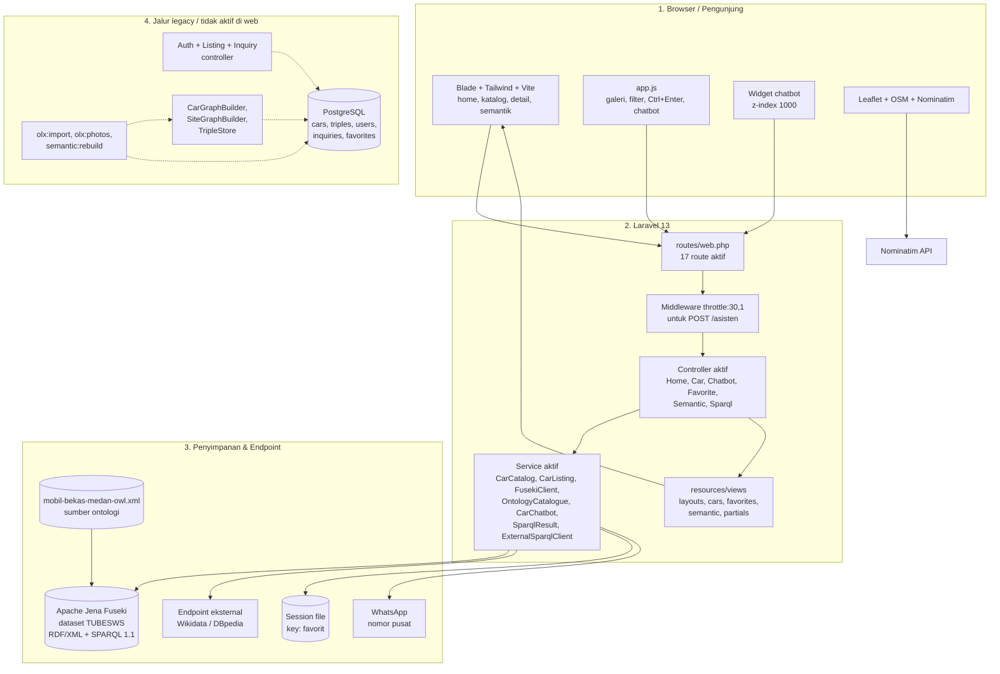
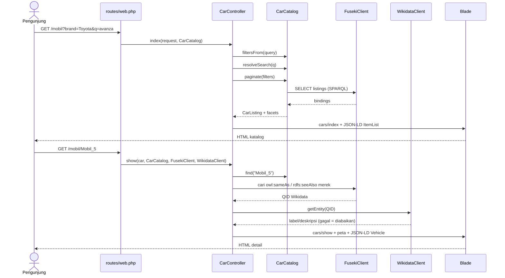
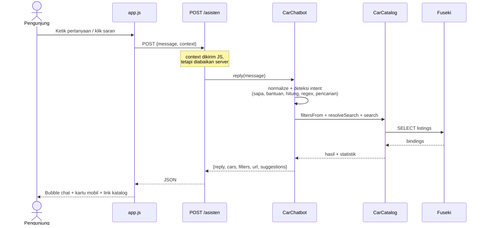
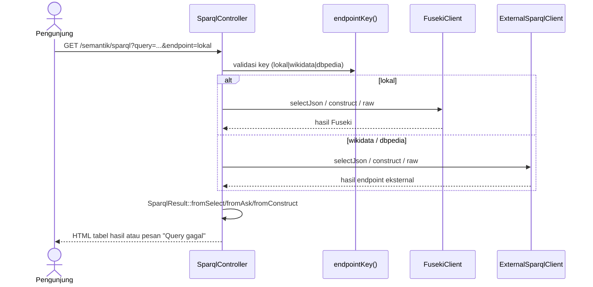

# Arsitektur Web — Mobil Bekas Medan

> Dokumen ini dibuat dari **kode yang benar-benar ada di working tree saat ini** (branch `main`, HEAD `548c5ad`), bukan hanya dari `README.md`. README masih menyimpan beberapa informasi lama; lihat bagian [9](#9-catatan-ketidaksesuaian-dokumentasi--kode).

---

## 1. Ringkasan

Aplikasi ini adalah **katalog mobil bekas berbasis web semantik** dengan Laravel 13 sebagai lapisan aplikasi dan **Apache Jena Fuseki** sebagai sumber data utama.

Karakteristik utama:

| Aspek | Kondisi saat ini |
|---|---|
| Sumber data katalog | Dataset RDF `TUBESWS` di Fuseki, dibaca lewat SPARQL |
| Chatbot | Rule-based/offline (`CarChatbot`), tanpa AI/Gemini |
| Favorit | Session-only, key `favorit` (bukan tabel DB aktif) |
| Peta | Leaflet + OpenStreetMap + Nominatim di browser |
| Frontend | Blade + Tailwind CSS 4 + Vite 8, JavaScript progresif |
| Data eksternal | Wikidata & DBpedia (hanya lewat daftar endpoint yang diizinkan) |
| PostgreSQL | Masih ada sebagai jalur **legacy/offline**, tidak dipakai route publik aktif |

Secara konseptual:

```text
Browser
  └─ Blade/Tailwind/JS
       └─ routes/web.php
            └─ Controller aktif
                 └─ Service (CarCatalog, OntologyCatalogue, CarChatbot, ...)
                      └─ FusekiClient ──► Fuseki (dataset TUBESWS)
                      └─ WikidataClient ──► Wikidata SPARQL
                      └─ ExternalSparqlClient ──► Wikidata / DBpedia
```

---

## 2. Diagram arsitektur keseluruhan



Legenda: garis **putus-putus** = kode masih ada, tetapi tidak terhubung ke route publik aktif.

---

## 3. Peta route aktif

Sumber: `routes/web.php`.

| Method | Path | Nama route | Controller | Fungsi |
|---|---|---|---|---|
| `GET` | `/` | `beranda` | `HomeController::index` | Beranda + statistik + facet |
| `GET` | `/mobil` | `mobil.index` | `CarController::index` | Katalog/filter/pencarian |
| `GET` | `/mobil/{car}.ttl` | `mobil.turtle` | `CarController::turtle` | Turtle per mobil |
| `GET` | `/mobil/{car}` | `mobil.show` | `CarController::show` | Detail mobil + peta + Wikidata |
| `POST` | `/asisten` | `chatbot.reply` | `ChatbotController::__invoke` | Balasan chatbot JSON |
| `GET` | `/favorit` | `favorit.index` | `FavoriteController::index` | Daftar favorit session |
| `POST` | `/favorit/{car}` | `favorit.store` | `FavoriteController::store` | Tambah favorit |
| `DELETE` | `/favorit/{car}` | `favorit.destroy` | `FavoriteController::destroy` | Hapus favorit |
| `GET` | `/semantik` | `semantik.index` | `SemanticController::index` | Ringkasan dataset |
| `GET` | `/semantik/rdfa` | `semantik.rdfa` | `SemanticController::rdfa` | Contoh RDFa |
| `GET` | `/semantik/mobil/{car}` | `semantik.show` | `SemanticController::show` | Triple per individu |
| `GET` | `/semantik/graph.ttl` | `semantik.graph` | `SemanticController::graph` | Unduh seluruh graf |
| `GET` | `/semantik/ontology` | `semantik.ontology` | `SemanticController::ontology` | Halaman ontologi |
| `GET` | `/semantik/ontology.xml` | `semantik.ontology.download` | `SemanticController::ontologyDownload` | Unduh RDF/XML |
| `GET` | `/semantik/sparql` | `semantik.sparql` | `SparqlController::index` | Konsol SPARQL |
| `GET\|POST` | `/semantik/sparql/query` | `semantik.sparql.query` | `SparqlController::query` | Endpoint SPARQL mentah |

Catatan:

- Parameter `{car}` dibatasi pola `Mobil_[0-9]+`.
- Route `.ttl` didefinisikan **sebelum** route detail agar tidak tertangkap sebagai `{car}`.
- Tidak ada route aktif untuk auth, CRUD iklan, atau inquiry.
- `AppServiceProvider` mendefinisikan rate limiter bernama `inquiries` dan `catalogue`, tetapi belum dipakai route mana pun. Chatbot memakai inline `throttle:30,1`.

---

## 4. Alur request utama

### 4.1 Katalog dan detail mobil



`CarCatalog` melakukan satu query SPARQL besar, meng-cache binding mentah selama `FUSEKI_CACHE_TTL` (default 300 detik), lalu melakukan filter, sort, facet, dan koreksi typo **di memory**.

### 4.2 Chatbot



Balasan chatbot selalu dibatasi pada katalog lokal; tidak ada pemanggilan LLM.

### 4.3 Konsol SPARQL



Endpoint eksternal **hanya dipilih berdasarkan key**, bukan URL bebas; URL tidak dikenal ditolak dengan HTTP 400.

---

## 5. Komponen aktif

### 5.1 Controller

| File | Peran |
|---|---|
| `app/Http/Controllers/HomeController.php` | Statistik beranda, featured/financing, JSON-LD `WebSite` + `SearchAction` |
| `app/Http/Controllers/CarController.php` | Index, detail, Turtle per mobil, JSON-LD `ItemList` dan `Vehicle` |
| `app/Http/Controllers/ChatbotController.php` | Validasi `message` dan delegasi ke `CarChatbot` |
| `app/Http/Controllers/FavoriteController.php` | CRUD session `favorit` |
| `app/Http/Controllers/SemanticController.php` | Overview dataset, RDFa, triple per individu, graf, ontologi |
| `app/Http/Controllers/SparqlController.php` | Konsol SPARQL + endpoint mentah + contoh query |

### 5.2 Service lapisan data

| File | Peran utama |
|---|---|
| `app/Services/Fuseki/FusekiClient.php` | HTTP client ke Fuseki: `select`, `selectJson`, `ask`, `construct`, `raw`, `update`, `upload`, `graph`, `ensureDataset`, `isAvailable` |
| `app/Services/Fuseki/SparqlResult.php` | Normalisasi hasil `SELECT`/`ASK`/`CONSTRUCT` untuk tampilan |
| `app/Services/Catalog/CarCatalog.php` | Query + hydrasi + filter + sort + facet + statistik + cache |
| `app/Services/Catalog/CarListing.php` | Value object readonly: harga, km, tahun, WhatsApp, JSON-LD `Vehicle` |
| `app/Services/Chatbot/CarChatbot.php` | Intent rule-based, alias merek/transmisi, regex, rekomendasi |
| `app/Services/Semantic/OntologyCatalogue.php` | Statistik+kelas+predikat+namespace+triple subjek+Turtle dari Fuseki |
| `app/Services/Sparql/ExternalSparqlClient.php` | Client GET ke Wikidata/DBpedia dengan timeout & User-Agent |
| `app/Services/Wikidata/WikidataClient.php` | Ambil label/deskripsi entitas QID untuk detail mobil |

### 5.3 Frontend

- `resources/views/layouts/app.blade.php`: header sticky, meta OG, JSON-LD, include partial chatbot.
- `resources/views/cars/*`, `semantic/*`, `favorites/*`, `home.blade.php`.
- `resources/views/partials/car-map.blade.php`: Leaflet + Nominatim; panel peta berada di bawah widget chatbot secara visual, sehingga chatbot memakai `z-[1000]` (Leaflet memakai z-index 400–800).
- `resources/views/partials/chatbot.blade.php`: widget dengan `data-chatbot-*`.
- `resources/js/app.js`: galeri, auto-submit filter, Ctrl/Cmd+Enter untuk editor SPARQL, panel chatbot + `fetch`.
- `resources/css/app.css`: Tailwind 4, tema `--color-brand-*`, utilitas `btn`, `card`, `field`, `chip`.
- `vite.config.js`: input CSS/JS + plugin Laravel, Tailwind, font Instrument Sans.

---

## 6. Sumber data dan integrasi

### 6.1 Fuseki sebagai source of truth

```text
mobil-bekas-medan-owl.xml
        │  php artisan fuseki:load --replace
        ▼
Fuseki dataset TUBESWS  (http://127.0.0.1:3030/TUBESWS)
        │  SPARQL 1.1
        ▼
CarCatalog / OntologyCatalogue / SparqlController
        ▼
Halaman katalog, detail, RDFa, Turtle, konsol SPARQL
```

`FusekiClient` melakukan POST ke `/TUBESWS/query`, retry 2× dengan jeda 250 ms, timeout default 30 detik, basic auth opsional. Operasi graf memakai `/TUBESWS/data?default`.

### 6.2 Data eksternal

| Integrasi | Dipakai oleh | Catatan |
|---|---|---|
| Wikidata SPARQL | `SparqlController` (key `wikidata`), `WikidataClient` | `WikidataClient` meng-hardcode URL, tidak membaca `WIKIDATA_SPARQL_URL` |
| DBpedia SPARQL | `SparqlController` (key `dbpedia`) | Hanya lewat daftar endpoint config |
| Nominatim | `car-map.blade.php` (browser) | Geocoding lokasi; fallback koordinat Medan |
| OpenStreetMap tiles | Leaflet | Peta lokasi unit |
| WhatsApp | `CarListing::whatsappUrl()` | Satu nomor pusat dari `config('services.whatsapp.number')`, bukan nomor penjual per iklan |

### 6.3 Favorit & session

`FavoriteController` menyimpan array ID di session key `favorit`. Tabel migrasi `favorites` dan relasi Eloquent masih ada, tetapi tidak dipakai route aktif. Driver session di `.env` = `file`; saat test = `array`.

---

## 7. Konfigurasi penting

| File | Konfigurasi utama |
|---|---|
| `config/fuseki.php` | `base_url`, `dataset`, auth, `timeout`, `ontology_path`, `ontology_url`, `namespace`, `cache_ttl` |
| `config/sparql.php` | `default`, endpoint `lokal`/`wikidata`/`dbpedia`, timeout, user agent |
| `config/semantic.php` | Nama situs, bahasa, mata uang, prefix namespace, datatype map |
| `config/services.php` | Nomor WhatsApp pusat |
| `config/maps.php` | Fallback lat/lng, zoom, suffix pencarian |
| `config/database.php` | Default `sqlite`, di-override `.env` ke `pgsql` |
| `config/cache.php` | Default `database`, di-override ke `file` (test: `array`) |
| `config/session.php` | Default `database`, di-override ke `file` (test: `array`) |
| `config/queue.php` | Default `database`, di-override ke `sync` |

Variabel `.env.example` yang relevan:

```dotenv
FUSEKI_URL=http://127.0.0.1:3030
FUSEKI_DATASET=TUBESWS
FUSEKI_TIMEOUT=30
FUSEKI_CACHE_TTL=300
FUSEKI_NAMESPACE="http://www.semanticweb.org/mobil-bekas-medan#"

SPARQL_DEFAULT_ENDPOINT=lokal
WIKIDATA_SPARQL_URL=https://query.wikidata.org/sparql
DBPEDIA_SPARQL_URL=https://dbpedia.org/sparql

WHATSAPP_NUMBER=085277027100
MAP_FALLBACK_LAT=3.5952
MAP_FALLBACK_LNG=98.6722
MAP_ZOOM=12
```

---

## 8. Console, import, dan pengujian

### 8.1 Command

| Command | Fungsi | Status |
|---|---|---|
| `php artisan fuseki:load [--replace] [--check]` | Pastikan dataset ada → unggah RDF/XML → flush cache → hitung triple | **Aktif**, sumber data publik |
| `php artisan semantic:rebuild [--chunk=200]` | Rebuild graf `catalog` di PostgreSQL | Legacy/offline |
| `php artisan olx:import [path] [--sheet=] [--no-images]` | Import Excel ke model Eloquent + graf legacy | Legacy/offline |
| `php artisan olx:photos [path] [--sheet=] [--force]` | Relink foto dari spreadsheet | Legacy/offline |
| `php artisan app:seed-showcase-listings` | Seed user demo + iklan contoh | Legacy/offline |
| `php check-sparql.php ["SELECT ..."]` | Uji cepat query SPARQL ke Fuseki | Diagnostik mandiri |

### 8.2 Test

`phpunit.xml` memakai:

- `APP_ENV=testing`
- `CACHE_STORE=array`
- `SESSION_DRIVER=array`
- `QUEUE_CONNECTION=sync`
- `DB_CONNECTION=sqlite`, `DB_DATABASE=:memory:`

Fuseki tidak dibutuhkan: `tests/Support/InteractsWithFuseki.php` mengganti `FusekiClient` dengan `FakeFusekiClient` berisi fixtures `Mobil_5`, `Mobil_6`, `Mobil_7`.

Cakupan:

| Grup | File |
|---|---|
| Beranda | `tests/Feature/HomePageTest.php` |
| Katalog/filter/regex/sort/Turtle | `tests/Feature/CatalogBrowsingTest.php` |
| Detail + WhatsApp + peta | `tests/Feature/CarContactAndMapTest.php` |
| Favorit session | `tests/Feature/FavoriteTest.php` |
| RDFa | `tests/Feature/RdfaPageTest.php` |
| Semantik + SPARQL + endpoint external | `tests/Feature/SemanticExplorerTest.php` |
| Chatbot | `tests/Feature/ChatbotTest.php` |
| Fuseki client | `tests/Unit/FusekiClientTest.php` |
| Graf legacy | `tests/Unit/CarGraphBuilderTest.php` |
| QueryResult/CSV/JSON | `tests/Unit/SparqlQueryResultTest.php` |

Tidak ada test untuk auth, listing CRUD, inquiry, atau import command.

---

## 9. Catatan ketidaksesuaian dokumentasi & kode

Bagian ini penting agar arsitektur tidak tertafsir salah dari README lama.

1. **Chatbot context tidak dipakai server.** JS mengirim `context.page` dan `context.car`, tetapi `ChatbotController` hanya memvalidasi `message` dan `CarChatbot::reply()` hanya menerima string.
2. **Nomor WhatsApp bukan dari data penjual.** `CarListing::whatsappUrl()` memakai satu nomor pusat dari config.
3. **PostgreSQL masih lebih besar dari yang didokumentasikan.** Model, migrasi, controller auth/listing/inquiry, graph builder, dan command import masih ada, meski tidak terhubung ke route aktif.
4. **Route favorit mutasi tidak ada di tabel README.** `POST/DELETE /favorit/{car}` sebenarnya aktif.
5. **View legacy merujuk route yang tidak terdaftar:** `daftar`, `masuk`, `iklan.create`, `iklan.saya`, `iklan.store`, `iklan.edit`, `iklan.destroy`, `iklan.status`, `iklan.foto.destroy`.
6. **`.env` masih menyimpan variabel Gemini** (`CHATBOT_PROVIDER`, `GEMINI_*`), tetapi tidak ada kode yang membacanya; file `AiChatbot`, `GeminiClient`, dan `config/gemini.php` sudah dihapus.
7. **`WikidataClient` meng-hardcode endpoint**, mengabaikan `WIKIDATA_SPARQL_URL` yang dipakai konsol SPARQL.
8. **Beberapa service bersifat inert:** `CarSearch`, `TripleStore`, `TurtleSerializer`, `PredicateCatalogue`, `JsonLdGenerator`, dan parser SPARQL lokal tidak dipanggil aplikasi aktif.
9. **Cache version key tidak dipakai.** `CarCatalog::forgetCache()` / `OntologyCatalogue::forgetCache()` tidak punya caller; `fuseki:load` memakai `Cache::flush()`.

---

## 10. Rekomendasi singkat

1. Perbarui `README.md` agar sesuai dengan dokumen ini, terutama chatbot, WhatsApp, dan tabel route.
2. Hapus atau tandai jelas kode legacy bila tidak direncanakan dipakai, agar tidak membingungkan pengembangan.
3. Bersihkan variabel `GEMINI_*`/`CHATBOT_PROVIDER` dari `.env` lokal.
4. Gabungkan konfigurasi URL Wikidata agar `WikidataClient` dan konsol SPARQL memakai satu sumber.
5. Jika auth/listing ingin diaktifkan kembali, daftarkan route yang sudah direferensikan Blade atau ubah view ke route aktif.

---

## 11. Cara menjalankan

```bash
composer install
npm install
cp .env.example .env
php artisan key:generate

# Data utama: unggah ontologi ke Fuseki
php artisan fuseki:load --replace

# Uji query SPARQL
php check-sparql.php
php check-sparql.php "SELECT * WHERE { ?s ?p ?o } LIMIT 5"

# Jalankan aplikasi
composer dev
```

Akses:

- Beranda: `/`
- Katalog: `/mobil`
- Detail: `/mobil/Mobil_5`
- Konsol SPARQL: `/semantik/sparql`
- Graf Turtle: `/semantik/graph.ttl`
