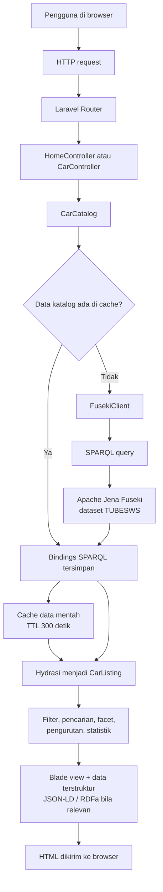
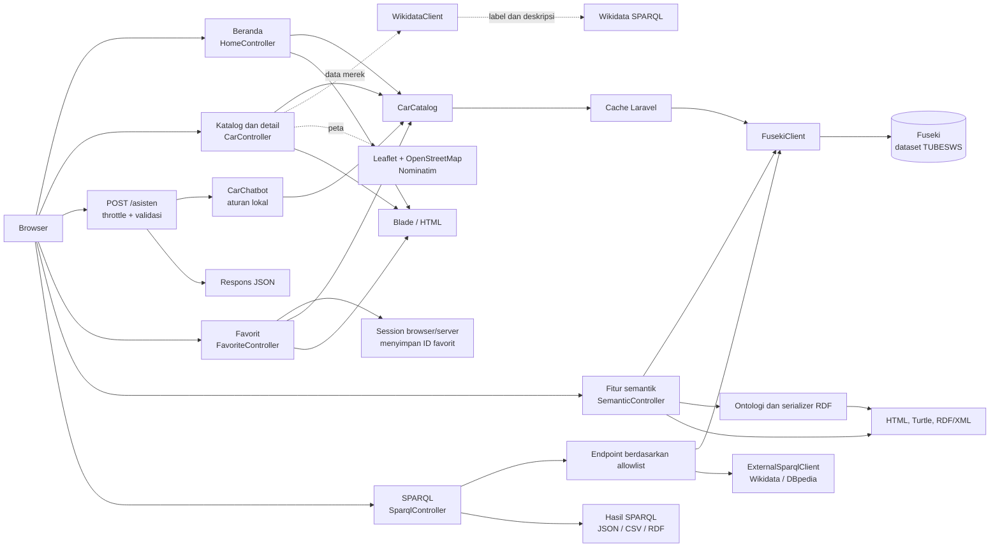

# Mobil Bekas Medan — Katalog Web Semantik

Aplikasi katalog **mobil bekas di Medan** berbasis Laravel yang seluruh data katalognya dibaca dari **Apache Jena Fuseki** (dataset `TUBESWS`) melalui SPARQL, bukan dari MySQL/PostgreSQL. Selain tampilan untuk manusia, setiap iklan juga dipublikasikan sebagai data yang bisa dibaca mesin: RDF, RDFa, JSON-LD, dan Open Graph.

> Nama aplikasi, deskripsi, dan namespace dapat diubah lewat variabel `SEMANTIC_*` di `.env`.

---

## Daftar isi

- [Fitur utama](#fitur-utama)
- [Pemetaan kebutuhan web semantik](#pemetaan-kebutuhan-web-semantik)
- [Arsitektur singkat](#arsitektur-singkat)
- [Instalasi & menjalankan aplikasi](#instalasi--menjalankan-aplikasi)
- [Rute penting](#rute-penting)
- [Konsol SPARQL](#konsol-sparql)
- [Asisten katalog](#asisten-katalog)
- [Format RDF & data terstruktur](#format-rdf--data-terstruktur)
- [Integrasi layanan eksternal](#integrasi-layanan-eksternal)
- [Pengujian](#pengujian)
- [Struktur direktori](#struktur-direktori)

---

## Fitur utama

1. **Beranda** — statistik iklan, merek, lokasi, harga tertinggi, pintasan cepat (bisa dicicil, termurah, tahun terbaru, ada foto), merek populer, dan iklan terbaru.
2. **Katalog mobil** — pencarian teks dengan koreksi typo (mis. `toyata` → `toyota`) dan mode regex; filter merek, jenis, transmisi, penggerak, bahan bakar, lokasi, harga, tahun, kilometer, cicilan, dan foto; pengurutan, pagination, serta URL filter yang bisa dibagikan.
3. **Detail iklan** — foto, spesifikasi, harga dan diskon, simulasi cicilan, layanan penjual, peta lokasi (Leaflet + OpenStreetMap/Nominatim), tombol WhatsApp, mobil terkait, dan informasi merek dari Wikidata.
4. **Favorit** — disimpan di session (tanpa login dan tanpa tabel database), dengan penanda jumlah di navbar.
5. **Asisten katalog** — menjawab dari katalog lokal dengan aturan (alias `mercy`, `vw`, regex `Toyota|Brio`, dll.); semua harga, jumlah, dan filter divalidasi terhadap dataset dan mengembalikan tautan katalog terfilter.
6. **Web semantik** — eksplorasi kelas/predikat OWL, statement RDF per individu, demo RDFa, unduhan graf Turtle, dan ontologi sumber RDF/XML.
7. **Konsol SPARQL** — menjalankan SELECT/ASK/CONSTRUCT terhadap dataset lokal **atau** endpoint publik Wikidata/DBpedia, dengan contoh query untuk masing-masing endpoint dan endpoint JSON mentah.

---

## Pemetaan kebutuhan web semantik

| Kebutuhan | Status | Lokasi di proyek |
|---|---|---|
| Aplikasi yang diakses dari desktop | ✅ | Aplikasi web responsif; buka di browser desktop. Belum ada build native Electron/Tauri. |
| File RDF | ✅ | `mobil-bekas-medan-owl.xml` (RDF/XML), `/mobil/{id}.ttl`, `/semantik/graph.ttl`, JSON-LD di halaman. |
| Laman RDFa | ✅ | `/semantik/rdfa` dan anotasi di halaman detail via `partials/rdfa-facts.blade.php`. |
| Open Graph Protocol | ✅ | `layouts/app.blade.php`: `og:type`, `og:site_name`, `og:title`, `og:description`, `og:url`, `og:image`, `og:locale`. |
| Dataset sendiri + SPARQL endpoint | ✅ | Dataset `TUBESWS` di Fuseki; endpoint `/query`, `/update`, `/data`; konsol di `/semantik/sparql`. |
| SPARQL endpoint eksternal | ✅ | Pemilih endpoint Wikidata/DBpedia di konsol + contoh query `SERVICE` federated; allowlist di `config/sparql.php`. |
| Integrasi layanan lain | ✅ | Wikidata (SPARQL), OpenStreetMap + Nominatim (peta/geocoding), dan deep link WhatsApp ke penjual. |

---

## Arsitektur singkat

### Alur permintaan katalog



`CarCatalog` mengambil katalog dari Fuseki melalui `FusekiClient`. Hasil query mentah disimpan di cache, kemudian diubah menjadi `CarListing` dan diproses di memori untuk pencarian, filter, facet, pengurutan, serta pagination. Katalog tidak dibaca dari PostgreSQL/MySQL.

### Alur fitur dan integrasi



### Ringkasan komponen

| Lapisan | Komponen | Tanggung jawab |
|---|---|---|
| Antarmuka | Browser, Blade, Tailwind, JavaScript | Menampilkan halaman, mengirim pencarian, dan menerima respons HTML/JSON/RDF. |
| Routing | `routes/web.php` dan controller Laravel | Memetakan URL ke proses beranda, katalog, favorit, asisten, dan web semantik. |
| Logika aplikasi | `CarCatalog`, `CarChatbot`, layanan semantik | Memvalidasi filter, menyusun hasil katalog, menjawab pertanyaan berbasis data lokal, dan menyiapkan representasi RDF. |
| Cache | Cache Laravel, TTL 300 detik | Mengurangi query berulang ke Fuseki; data katalog mentah di-cache sebelum diproses. |
| Penyimpanan katalog | Apache Jena Fuseki, dataset `TUBESWS` | Sumber data katalog dan graf RDF yang dibaca aplikasi melalui SPARQL. |
| State pengguna | Session Laravel | Menyimpan ID mobil favorit; tidak menggunakan tabel database untuk favorit. |
| Integrasi | Wikidata, DBpedia, OpenStreetMap/Nominatim | Menyediakan informasi merek, query SPARQL eksternal, dan peta. |

Untuk memuat ulang graf sumber RDF/XML setelah Fuseki berjalan, jalankan `php artisan fuseki:load --replace`. Perintah ini mengunggah graf ke dataset dan membersihkan cache Laravel agar permintaan berikutnya membaca data terbaru.

---

## Instalasi & menjalankan aplikasi

### 1. Dependensi

```bash
composer install
npm install
cp .env.example .env
php artisan key:generate
```

### 2. Apache Jena Fuseki

Pastikan Fuseki berjalan di `http://127.0.0.1:3030`, lalu muat ontologi/dataset:

```bash
php artisan fuseki:load --replace
```

Cek koneksi tanpa mengubah data:

```bash
php artisan fuseki:load --check
```

Variabel related di `.env`:

```dotenv
FUSEKI_URL=http://127.0.0.1:3030
FUSEKI_DATASET=TUBESWS
FUSEKI_NAMESPACE="http://www.semanticweb.org/mobil-bekas-medan#"
FUSEKI_ONTOLOGY=mobil-bekas-medan-owl.xml
FUSEKI_CACHE_TTL=300

# Opsi konsol SPARQL eksternal
SPARQL_DEFAULT_ENDPOINT=lokal
WIKIDATA_SPARQL_URL=https://query.wikidata.org/sparql
DBPEDIA_SPARQL_URL=https://dbpedia.org/sparql

```

> Koneksi PostgreSQL lama sengaja dibiarkan di `config/database.php` untuk kebutuhan lain, tetapi **tidak dipakai** untuk katalog.

### 3. Jalankan aplikasi

```bash
npm run build     # atau: npm run dev
php artisan serve
```

Buka `http://localhost:8000`.

---

## Rute penting

| Rute | Fungsi |
|---|---|
| `GET /` | Beranda |
| `GET /mobil` | Katalog + filter + pencarian |
| `GET /mobil/Mobil_{id}` | Detail iklan (RDFa + peta + WhatsApp) |
| `GET /mobil/Mobil_{id}.ttl` | Turtle untuk satu iklan |
| `POST /asisten` | Balasan chatbot (JSON, opsional membawa `context.page` dan `context.car`) |
| `GET /favorit` | Daftar favorit dari session |
| `GET /semantik` | Statistik dan struktur dataset |
| `GET /semantik/rdfa` | Contoh laman RDFa |
| `GET /semantik/mobil/{id}` | Statement RDF satu iklan |
| `GET /semantik/graph.ttl` | Unduh seluruh graf (Turtle) |
| `GET /semantik/ontology` | Penjelasan dan unduhan ontologi RDF/XML |
| `GET /semantik/sparql` | Konsol SPARQL (lokal/Wikidata/DBpedia) |
| `GET|POST /semantik/sparql/query` | Endpoint SPARQL mentah (JSON/CSV/Turtle/RDF-XML/N-Triples) |

---

## Konsol SPARQL

Konsol di `/semantik/sparql` memiliki pemilih endpoint:

- **`lokal`** — dataset `TUBESWS` di Fuseki. Contoh: agregasi harga per merek, `OPTIONAL`, `FILTER NOT EXISTS`, dan federasi lokal + Wikidata.
- **`wikidata`** — `https://query.wikidata.org/sparql`. Contoh: `wdt:P31`, `wikibase:label`, dan `ASK`.
- **`dbpedia`** — `https://dbpedia.org/sparql`. Contoh: properti entitas dan filter bahasa.

Endpoint ditentukan oleh **kunci**, bukan URL bebas. Daftar dan batasannya ada di `config/sparql.php`, sehingga konsol tidak bisa disalahgunakan sebagai proxy HTTP sembarangan.

Contoh pemakaian endpoint mentah:

```bash
curl -G -s "http://127.0.0.1:3030/TUBESWS/query" \
  --data-urlencode "query=SELECT * WHERE { ?s ?p ?o } LIMIT 5" \
  -H "Accept: application/sparql-results+json"
```

```bash
curl -G -s "https://query.wikidata.org/sparql" \
  --data-urlencode "query=ASK { wd:Q80305 wdt:P31 wd:Q4830453 }" \
  -H "Accept: application/sparql-results+json" \
  -H "User-Agent: TUBESWS/1.0"
```

Parameter `endpoint=lokal|wikidata|dbpedia` juga diterima oleh rute `/semantik/sparql/query`. Nilai di luar daftar ditolak dengan HTTP 400.

---

## Asisten katalog

Asisten menjawab hanya dari katalog lokal dengan aturan yang sama seperti pencarian di halaman katalog:

- **Grounding**: kosakata merek, lokasi, jenis, transmisi, penggerak, bahan bakar, dan statistik diambil dari graf yang sama dengan katalog.
- **Koreksi typo**: `q` melewati `CarCatalog::resolveSearch()`, sehingga `toyata` menjadi `toyota` dan koreksinya ikut ke URL katalog.
- **Regex**: kata kunci `regex`, `pola`, atau `pattern` diteruskan sebagai `q` + `regex=true` ke katalog, divalidasi sebelum query.
- **Tanpa layanan eksternal**: tidak memanggil API, tidak memakai API key, dan tidak mengirim data ke pihak ketiga.

Rute `POST /asisten` tetap dibatasi throttle 30 request/menit.
## Format RDF & data terstruktur

| Bentuk | Contoh | Keterangan |
|---|---|---|
| RDF/XML | `mobil-bekas-medan-owl.xml` | Ontologi + data sumber yang diunggah ke Fuseki. |
| Turtle | `/mobil/Mobil_5.ttl`, `/semantik/graph.ttl` | Satu individu atau seluruh graf. |
| RDFa 1.1 | `/semantik/rdfa`, halaman detail | `vocab`, `typeof`, `prefix`, `property`, `content`. |
| JSON-LD | `<script type="application/ld+json">` di layout | `WebSite`, `SearchAction`, `BreadcrumbList`, `ItemList`, `Vehicle`. |
| Open Graph | tag `og:*` di layout | Judul, deskripsi, URL, dan gambar saat dibagikan. |

---

## Integrasi layanan eksternal

- **Wikidata** — halaman detail mencari tautan `owl:sameAs`/`rdfs:seeAlso` di graf lokal, lalu mengambil label dan deskripsi entitas melalui endpoint SPARQL Wikidata. Kegagalan jaringan tidak membuat halaman error.
- **OpenStreetMap / Nominatim** — peta Leaflet dengan tile OSM dan geocoding nama kecamatan; fallback ke pusat Medan bila geocoding gagal.
- **WhatsApp** — tombol “Tanya via WhatsApp” memakai nomor penjual dari data iklan jika tersedia.
- **Asisten katalog** — berjalan offline dari kosakata yang memang ada di graf.

---

## Pengujian

```bash
php artisan test
```

Test feature memakai `FakeFusekiClient` dan `Http::fake`, sehingga tidak membutuhkan Fuseki maupun akses internet. Cakupan meliputi katalog, chatbot aturan, favorit, RDFa, graf Turtle, halaman detail, dan konsol SPARQL lokal/eksternal.

---

## Struktur direktori

```
app/
├── Http/Controllers/       # Home, Car, Favorite, Chatbot, Semantic, Sparql
├── Services/
│   ├── Catalog/            # CarCatalog, CarListing, pencarian & filter
│   ├── Fuseki/             # FusekiClient, SparqlResult
│   ├── Sparql/             # ExternalSparqlClient (Wikidata/DBpedia)
│   ├── Semantic/           # Ontologi, builder graf, serialisasi Turtle
│   └── Wikidata/           # WikidataClient
config/                     # fuseki.php, semantic.php, sparql.php, maps.php
database/                   # skema lama (tidak dipakai katalog)
resources/views/
├── cars/ semantic/ favorites/
├── partials/               # rdfa-facts, car-map, chatbot
└── layouts/app.blade.php   # SEO, Open Graph, JSON-LD, navigasi
tests/                      # Feature + Unit + FakeFusekiClient
mobil-bekas-medan-owl.xml   # sumber RDF/XML
```
